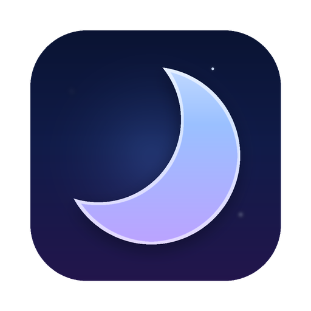

# Deep Sleep

> **[English README](./README.md)** | 中文

<p align="center">
  
</p>


原生 Swift 写的 macOS 睡眠管理器。用来保持清醒、彻底禁止休眠，也能定时睡眠与计划唤醒。

- **Bundle ID**：`com.skyc8266.deepsleep`
- **应用名**：Deep Sleep
- **最低系统**：macOS 26.0
- **语言 / 框架**：Swift 5、SwiftUI + AppKit、IOKit、LocalAuthentication
- **当前版本**：1.8.2

## 安装

```sh
brew install mofan2020/tap/deepsleep
```

或者从 [Releases](https://github.com/Mofan2020/DeepSleep/releases) 下载 `DeepSleep.zip`，
解压后把 `Deep Sleep.app` 放进 `/Applications`。

应用是 ad-hoc 签名，首次打开若被系统拦下，到「系统设置 → 隐私与安全性」里点「仍要打开」。
想自己构建见下文。

## 功能

### 保持清醒

| 能力 | 说明 | 需要授权 |
| --- | --- | --- |
| 阻止空闲睡眠 | 等同 `caffeinate -i`，系统不再因无操作而睡眠 | 否 |
| 保持屏幕常亮 | 显示器不因空闲关闭 | 否 |
| 阻止系统睡眠 | 合盖也不睡 | 是（完全控制） |

### 完全控制

一次管理员授权装上特权助手，之后这些能力长期可用，不再要求管理员密码：

- 阻止系统睡眠（含合盖）：由助手持有 `PreventSystemSleep` 断言
- 完全禁止系统睡眠：写入 `pmset -a disablesleep 1`，重启后依然生效
- 电源设置读写：`sleep`、`displaysleep`、`disksleep`、`hibernatemode`、`powernap`、
  `womp`、`ttyskeepawake`、`lowpowermode`、`autorestart`、`lidwake` 等
- 计划唤醒：`pmset schedule wake`，由系统电源服务执行

「停用并卸载」会把 `/Library` 下的文件与 launchd 任务全部移除，系统回到安装前的状态，
也可以手动执行 `DeepSleep/Resources/uninstall-helper.sh`。

### 自动化规则

规则由「触发条件」和「要保持的状态」组成，引擎每 5 秒评估一次：

- 时间段：工作日 09:00–18:00 保持清醒，支持跨零点区间
- 电源状态：接入电源时 / 使用电池时
- 应用运行中：指定的应用在前台运行时

规则只表达意图，申请与释放由控制器统一处理，所以规则和手动开关不会互相打架。

### 交给系统自动化

| 通道 | 怎么用 |
| --- | --- |
| Siri | 说「用 Deep Sleep 保持清醒」「用 Deep Sleep 查询睡眠状态」，完整短语用 `--automation` 查看 |
| 快捷指令 | 「快捷指令」App 里直接有 Deep Sleep 的动作，可以拼进任何自动化流程 |
| 自动操作 / AppleScript / shell | 调用 `deepsleep://` URL，见下文 |
| 聚焦 / 控制中心 | 上面的动作也会出现在这里 |

### 快速退出

指定一个全局快捷键（默认 **⌥⇧⌘H**，可在界面里重新录制），按下就把选定的应用连同全部子进程一起结束。

- 这是强制结束，不等待保存，也不给应用收尾的机会
- 系统进程有硬编码名单保护（Finder、Dock、WindowServer、powerd、tccd 等，
  完整清单见 [docs/architecture.md](docs/architecture.md) 第六节）。命中的进程连同整棵子树一起跳过，没有开关能绕过
- 需要 root 的进程交给特权助手；助手不可达时退回本进程权限，并在结果里说明
- 名单里的应用没在运行时，结果会写「未在运行」
- 「演练一次」只列出会结束哪些进程，不动手

### 其他

- 倒计时睡眠
- 工具箱：所有工具收在一页，卡片可置顶（进程优先级 / Hosts 编辑 / Quarantine / AI 保活）
- AI 保活：每天固定时刻给订阅制 AI 服务发一条极短请求，让使用窗口别闲置到点重置
- 菜单栏常驻：左键打开主界面，右键弹出快速设置，Control + 左键等同右键
- 关掉所有窗口后隐藏 Dock 图标，应用继续在菜单栏后台运行
- 运行日志页，按条数与天数自动裁剪
- 外部活动：谁在阻止休眠，谁改了电源设置
- 应用与特权助手都能自我更新

### 系统监控

- **开机自启**：默认开，写入 `~/Library/LaunchAgents/com.skyc8266.deepsleep.plist`；
  「完全控制」页可关。用户主动退出后不会被强行唤起。
- **CPU / RAM 过载告警**：连续 N 秒超过阈值时提示前三大占用的进程，
  用户可冻结（SIGSTOP）或结束（SIGKILL），也可忽略。
- **单进程 RAM 超阈告警**：任一进程 RSS 超过设定值立刻提示（不等持续）。
- **CPU 温度超阈告警**：暂不可用 —— macOS 26/27 的 Apple SMC 公开接口实测返回 `kIOReturnNotFound / kIOReturnUnsupported` / `result=0` 但 `dataSize=0`（本机实测，开发笔记 [notes.md](docs/notes.md) 有完整诊断记录），重构中，下次更新放出；其它监控项不受影响。先占位 UI「等待后续更新」。
- **完全卸载**：撤销所有断言，恢复 disablesleep，清理配置（Preferences / Caches / Application Support / Saved State / Logs），卸载助手，删除自启 plist，删除 .app 包。侧栏「卸载 Deep Sleep」项入口。

## 命令行接口

Deep Sleep 可以被脚本调度：

```sh
open -a "Deep Sleep" --args --hold idle-system,display
open -a "Deep Sleep" --args --release
open -a "Deep Sleep" --args --status
```

| 参数 | 说明 |
| --- | --- |
| `--hold <kinds>` | 逗号分隔。接受 `idle-system` / `display` / `system`，以及 `idle`、`screen`、`lid`、`all` 等别名 |
| `--release` | 释放全部保持 |
| `--status` | 输出当前状态，含 `powerWatcher=`、`audits=` 等诊断字段 |
| `--wait <秒>` | 与 `--status` 配合，等一段时间后再报告（用于验证对账频率） |
| `--enable-full-control` | 触发一次性管理员授权安装特权助手，等价于界面按钮 |
| `--disable-full-control` | 卸载特权助手并恢复系统原状 |
| `--window-self-test` | 自检窗口显示与 Dock 图标策略（关窗 → 隐藏 Dock → 重开 → 恢复） |
| `--blockers` | 列出当前所有在阻止休眠的进程 |
| `--changes` | 列出检测到的电源设置改动（区分自身与外部） |
| `--rivals` | 列出其他会修改电源设置的程序 |
| `--helper-version` | 显示特权助手的版本状态（与内置那份的摘要比对结果） |
| `--helper-update` | 手动检查并按内置的那一份更新助手（与界面「立即检查并更新」同一条路径） |
| `--update-check` | 立即检查应用更新并输出结果 |
| `--update-script` | 打印将要执行的更新器脚本（只打印，不执行；用于人工审查） |
| `--quick-quit` | 立刻执行一次快速退出（结束选定的应用及其全部子进程） |
| `--dry-run` | 与 `--quick-quit` 配合：只列出会结束哪些进程，不动手 |
| `--automation` | 打印 Siri 短语与 `deepsleep://` 的命令清单 |
| `--hotkey-status` | 打印快速退出快捷键的注册状态（排查「按了没反应」） |
| `--autostart` | 由 LaunchAgent 自启动时传的参数：不抢主窗口焦点，仅跑菜单栏与监控 |
| `--server-mode <0\|1>` | 开启或关闭服务器模式（系统永不睡眠 + 定时关屏锁屏） |
| `--nice <pid> <value>` | 把 pid 的 nice 设为 value（[-20, 19]）；系统进程会被助手拒绝 |
| `--hosts <sub>` | Hosts 编辑：list（白名单）/ read（打印原文）/ write <file>（用文件覆盖）/ allow [uids=...] [names=...]（更新白名单） |
| `--quarantine <sub>` | Quarantine 属性：scan <dir>（列出带属性的文件）/ clear <dir>（清除），支持 `--no-recursive` / `--no-hidden` |

> `--hold` 与 `--release` 作用于启动它的那个实例。macOS 是单实例机制，
> 对已经在运行的实例再传参不会生效。需要脚本持续控制时，请用下面的 URL 或自动化规则。

### `deepsleep://` URL 接口

```sh
open "deepsleep://hold?kind=idle-system,display&minutes=60"
open "deepsleep://release"
open "deepsleep://quick-quit?dry-run=1"
```

URL 每次都会送到正在运行的那个实例，所以比命令行参数更适合重复调用。
AppleScript 用 `open location "deepsleep://release"`，自动操作用「打开 URL」动作。
完整的命令表与参数见 [docs/architecture.md](docs/architecture.md) 的「URL 命令一览」。

## 服务器模式

让一台 Mac 当服务器用：系统永不睡眠，开启后 5 秒自动关屏 + 锁屏，
空闲 10 分钟再重复一次。屏幕关掉之后倒计时停在零，不再反复关屏；
你回来操作后重新开始计。

```sh
open "deepsleep://server-mode?value=1"
```

实现要点：

- 系统不睡通过 `pmset disablesleep=1` + 特权助手持有的 PreventSystemSleep 断言双重落实，与「完全禁止睡眠」共用对账层。
- 关屏走 `pmset displaysleepnow`。**锁屏依赖系统设置 → 锁屏 → 立即要求密码**：勾上之后，关屏即等同 macOS 要求输入密码（Deep Sleep 不写 `~/Library/Preferences/com.apple.screensaver.plist`，所以不会偷偷改你的偏好）。
- 服务器模式期间系统监控若启用：仅告警，不弹冻结 / 终结对话框。
- 退出时 `disablesleep` 自动恢复为 0。

参数：

- 首次关屏延迟：默认 5 秒，UI 可调 0–60 秒。
- 空闲阈值：默认 10 分钟，UI 可调 1–60 分钟。
- 空闲检测方式：默认「内核空闲计时」，不需要任何系统授权；另有「事件监听」可切换，那条路需要「辅助功能」授权。

可用入口：侧边栏「系统控制 → 服务器模式」、`deepsleep://server-mode?value=1|0`、
Siri「用 Deep Sleep 开启/关闭服务器模式」、`--server-mode 0|1`。

## 进程优先级（nice）

查看与调整任何非系统进程的 nice 值。

```sh
open "deepsleep://nice?pid=1234&value=5"
```

nice 是 POSIX 的 CPU 调度建议值：`-20` 最优先，`+19` 最让权，`0` 是默认。

- **正值（>0）也必须走 root**：POSIX 的硬约束，应用层无特权也不能调高。
- **改错值会让系统变卡**：负值会跟系统进程抢 CPU；系统进程一律被 Deep Sleep 拒绝。
- **极端值（≤ -10 或 ≥ +15）需要二级确认**：给一句"仍然继续"才生效，由用户自己拍板。负值会让进程跟系统抢资源、正值会让进程几乎拿不到 CPU 时间片。
- 本工具等价于 `sudo renice <value> <pid>`。

被拒绝的目标：pid 1、内核任务、`launchd` / `WindowServer` / `powerd` 等系统进程、
bundle id 在保护名单里的 Apple 应用、可执行文件落在 `/System/Library/` /
`/usr/libexec/` / `/usr/sbin/` / `/usr/bin/` / `/bin/` / `/sbin/` 下的任何进程。

可用入口：侧边栏「工具箱 → 进程优先级」、`deepsleep://nice?pid=<pid>&value=<v>`、
Siri「用 Deep Sleep 调整进程优先级」（提供 pid + value 两个参数）、
`--nice <pid> <value>`。

页面分页：默认每页 20 个进程，可在顶部 / 底部 Stepper 调 10–30。改后落到 `monitorConfig.v1`，下次打开自动恢复。

## Hosts 编辑

读写 `/etc/hosts`，管理「谁能改 hosts」白名单。

写 hosts 必须 root，所以这条路径走特权助手：

- 助手收到 `writeHosts` 后会先检查调用方 uid 是否在 `hosts.editors` 白名单内（白名单为空时放行任何 uid）；
- 写之前备份原文到 `/etc/hosts.deepsleep.bak`；
- 写完后强制把 owner 设回 `root:wheel`、mode `0644`，不让任何调用方把 hosts 变成可执行。

白名单改动本身也走助手（`setHostsEditors`），且只有当前白名单内的 uid 才能改它 —— 避免普通 uid 加自己。

```sh
open "deepsleep://hosts-read"           # 读全文
open "deepsleep://hosts-editors?uids=501,502&names=mofan"  # 改白名单
```

可用入口：侧边栏「工具箱 → Hosts 编辑」、`deepsleep://hosts-read|hosts-write|hosts-editors`、
`--hosts list|read|write <file>|allow [uids=...] [names=...]`。

## Quarantine 属性管理

macOS 给下载下来的文件打 `com.apple.quarantine` 扩展属性，双击时 Gatekeeper 会弹「未知开发者」提示。本工具扫目录、批量去掉这个属性，让文件下次双击走「非隔离」分支（不绕过签名校验、不绕过公证）。

- 不动 symlink：源文件的隔离标记属于它真正的来源，不是当前扫描目录的判定范围；
- 只删 `com.apple.quarantine`，不动其他扩展属性；
- 单个属性删除是 libc 级原子操作，不存在「删了一半」状态；
- 整个流程走本进程 xattr，不需要完全控制。

```sh
open "deepsleep://quarantine-scan?path=~/Downloads"
open "deepsleep://quarantine-clear?path=~/Downloads"
```

可用入口：侧边栏「工具箱 → Quarantine」、
`deepsleep://quarantine-scan|quarantine-clear`、
`--quarantine scan|clear <dir> [--no-recursive] [--no-hidden]`。

## 工具箱

所有工具收在一个页面上。侧边栏只有一个「工具箱」入口，每个工具是一张卡片。
点卡片进入该工具，点图钉把卡片置顶，「重置排序」恢复默认顺序。

| 卡片 | 做什么 |
| --- | --- |
| 进程优先级 | 查看与修改任何非系统进程的 nice 值 |
| Hosts 编辑 | 读写 `/etc/hosts`，管理「谁能改 hosts」白名单 |
| Quarantine | 扫描目录，清除文件上的 `com.apple.quarantine` 属性 |
| AI 保活 | 每天固定时刻给订阅制 AI 服务发一条极短请求 |

## AI 保活

订阅制 AI 服务（Claude、Codex、Gemini、DeepSeek 这类）通常有一个「从你上次使用开始算」
的滚动使用窗口。放着不用，窗口到点重置。

AI 保活在你设定的时刻，给你指定的服务发一条极短的请求，让窗口一直续着。

每天发几次、在哪几天发，都由你定。时刻精确到分钟，按本机时区算。

每条任务要填这些：

| 字段 | 填什么 |
| --- | --- |
| 服务地址 | 服务端地址，例如 `https://api.anthropic.com`。末尾有没有 `/v1` 都行 |
| 请求格式 | `OpenAI`（Bearer 认证，`/v1/chat/completions`）或 `Anthropic`（`x-api-key`，`/v1/messages`） |
| 模型名 | 服务支持的模型即可。「刷新模型列表」从服务端拉名字，也能手填 |
| API Key | 存在 macOS 钥匙串里，不写进偏好设置，不出现在日志中 |
| 发送时刻 | 一天里的几个时刻。默认 09:00 与 14:00 |
| 运行日 | 每周哪几天跑。默认周一到周五 |
| 请求内容 | 发出去的文本。默认让模型回一句 `ping`。「恢复默认模板」可以还原 |

几点说明：

- 每条请求只要求 1 个 token 的输出，消耗极低，但仍会记进该服务的用量统计。
- 滚动窗口怎么重置由服务端决定。Deep Sleep 按计划把请求发出去，
  窗口能不能因此续住，看服务自己的规则。
- 没选中的那几天不发请求，那几天的窗口会自然重置。
- 到点时 Deep Sleep 没开着，这个时刻就跳过，下一个时刻重新开始。
- Deep Sleep 退出后保活就停了。

## 外部活动

电源控制往往是几个程序在抢，Deep Sleep 只保证自己那一份。

```sh
open -a "Deep Sleep" --args --blockers   # 谁在阻止休眠
open -a "Deep Sleep" --args --changes    # 谁改了电源设置
open -a "Deep Sleep" --args --rivals     # 谁在跟 Deep Sleep 抢
```

`--blockers` 直接向内核取所有电源断言，按进程分组，并标出 Deep Sleep 自己。
`UserIsActive` 这类表示「用户正在操作」的断言不计入。

`--changes` 每 6 秒对 `pmset -g` 做一次快照比对，能给出改了什么、从什么变成什么、
什么时候，以及是不是 Deep Sleep 自己改的。macOS 没有公开 API 能查出是哪个进程写进去的，
所以这里不猜进程名。

`--rivals` 扫描正在运行的非 Apple 应用，在二进制里找 `disablesleep` /
`SleepDisabled` 字符串，用来找出那些直接改系统设置的程序，例如 AlDente。
读不到文件一律当作「不是」，宁可漏报也不误报。

检测到冲突只把事实列出来，不会去关掉别的程序。

## 权限与安全

真正彻底的睡眠控制都需要 root，所以这里用「一次性安装、长期驻留」的助手，避免每次操作都弹密码框：

1. 在「完全控制」页点「启用完全控制」，系统弹出一次管理员授权
   （已录入 Touch ID 的机器可以直接用指纹确认）
2. 授权用于把助手二进制写入 `/Library/PrivilegedHelperTools/`，
   并注册一个 launchd LaunchDaemon 让它常驻
3. 之后的提权操作只需要 Touch ID / 登录密码做本地确认，再经 UNIX socket 交给助手执行

助手侧的防护：

- socket 在 `/var/run/com.skyc8266.deepsleep.sock`，归当前登录用户所有，权限 `0600`
- 每个连接都用 `getpeereid()` 校验对端 uid，非登录用户直接拒绝
- 可写入的 `pmset` 键有白名单，取值必须是纯数字
- 只接受固定的命令枚举，不执行任何外部传入的 shell 字符串
- 必须以 root 运行，否则直接退出

## 更新

两条互不影响的更新路径。

**应用自己。** 启动 15 秒后拉取 Release 列表，取版本号最高的一条（跳过草稿，
保留预发布），下载其中名为 `DeepSleep.zip` 的资产。只有版本号严格更高时才更新，
版本号解析失败按「没有更新」处理。

安装前要过这几道检查，任何一步不过就放弃：

| 检查 | 排除的情况 |
| --- | --- |
| zip 能解开 | 中断的下载 |
| 里面的 `.app` 的 bundle id 是 `com.skyc8266.deepsleep` | 拿错了东西 |
| 版本号与 Release 声称的一致 | 版本错配 |
| 通过 `codesign --verify` | 包结构损坏 |
| Release 附了 `DeepSleep.zip.sha256` 时比对摘要 | 内容被改动 |

替换由临时目录里的独立脚本完成，脚本先等应用退出，再「挪走旧的、放入新的」，
任一步失败都回滚。可以先用 `--update-script` 把脚本打印出来人工审查。

**特权助手。** 助手装在 `/Library/PrivilegedHelperTools/`，可能落后于应用内置的那一份。
它是 root 常驻，能自己替换自己（`updateSelf`），所以更新不需要再授权一次。

- 应用启动后自动检查一次，两份内容不同就地替换；失败时本轮不再试，原因显示在「更新」页
- 也可以在「更新」页点「立即检查并更新」：先检查，有差异会弹框说明并询问，确认后更新
- 判据是两份二进制的内容摘要，不是版本号。只改了应用、没动助手时摘要不变，助手不会白重启一遍
- 旧版助手不认识 `updateSelf`，会返回解码错误而不是崩溃。这种情况需要重新授权安装一次

## 已知限制

- 合盖时能否被定时唤醒取决于机型与电源状态，Apple Silicon 机型合盖时通常不会被唤醒
- 取消唤醒会清掉所有由 `pmset` 排定的唤醒任务，包括别的程序排的
- 分发版本需要自己的开发者证书，ad-hoc 签名只适合本机使用

## 自己构建

需要 Xcode 26 以上（含 macOS 26 SDK）与 [XcodeGen](https://github.com/yonaskolb/XcodeGen)。

```sh
brew install xcodegen

cd DeepSleep
xcodegen generate                     # 由 project.yml 生成 DeepSleep.xcodeproj

xcodebuild -project DeepSleep.xcodeproj -scheme DeepSleep \
           -configuration Release -derivedDataPath build build

open "build/Build/Products/Release/Deep Sleep.app"
```

构建时会自动把 `deepsleep-helper` 嵌进
`Deep Sleep.app/Contents/Library/PrivilegedHelperTools/`。
`project.yml` 里配置的是 ad-hoc 签名，本机可以直接运行。

## 项目结构

```
DeepSleep/
├── project.yml                     XcodeGen 工程定义
├── Shared/                         两个 target 共用的代码
│   ├── HelperProtocol.swift        命令 / 响应 / 常量定义
│   ├── UnixSocket.swift            UNIX socket 封装（长度前缀分帧）
│   ├── PMSetOutput.swift           `pmset -g` 解析（app 与助手共用一份）
│   ├── Version.swift               版本号解析与比较（自动更新的判断依据）
│   ├── ProcessInventory.swift      进程枚举与进程树（快速退出用）
│   ├── ProcessSnapshot.swift       进程统计快照（RSS / CPU% / 启动时间）
│   ├── ProcessStats.swift          进程快照的共享编解码
│   ├── ProcessGuard.swift          强杀保护名单与「该杀谁」的裁决
│   └── TerminationReport.swift     强杀结果的结构与编解码
├── DeepSleep/                      主应用
│   ├── DeepSleepApp.swift          App 入口（主窗口场景）
│   ├── AppDelegate.swift           生命周期 + 命令行接口 + URL 入口
│   ├── Windows/
│   │   ├── MenuBarController.swift 菜单栏图标：左键打开 / 右键设置
│   │   └── WindowCoordinator.swift 主窗口显示与 Dock 图标策略
│   ├── Core/
│   │   ├── AssertionKind.swift     断言类型定义（能力清单）
│   │   ├── SleepController.swift   核心状态机：意图合并 → 实际持有
│   │   ├── PowerWatcher.swift      电源事件监听（睡前拦截 + 唤醒对账）
│   │   ├── PowerActivityMonitor.swift  外部活动：谁在阻止休眠 / 谁改了设置
│   │   ├── UpdateManager.swift     应用自更新：检查、校验、替换
│   │   ├── HelperVersionManager.swift  助手版本检测与自我更新
│   │   ├── AutomationRule.swift    自动化规则模型
│   │   ├── AutomationEngine.swift  规则求值引擎
│   ├── QuickQuit.swift         快速退出引擎（目标名单 → 进程树 → 强杀）
│   ├── GlobalHotkey.swift      全局快捷键（Carbon，不需要辅助功能权限）
│   ├── URLCommands.swift       `deepsleep://` 命令表与解析
│   ├── AutoStartManager.swift  LaunchAgent plist 读写（开机自启）
│   ├── SystemMonitor.swift     CPU/RAM 过载 + 单进程 RAM 阈值采样循环
│   ├── ProcessStatsProvider.swift  应用侧的进程统计 / 挂起 / 杀进程入口
│   ├── MonitorConfig.swift     配置持久化（UserDefaults JSON）
│   ├── AlertWindowController.swift 红字置顶对话框
│   ├── SystemNotifier.swift    UserNotifications 封装（含可点 action）
│   ├── MonitoringCoordinator.swift  SystemMonitor → Alert/Notifier 接线
│   └── Uninstaller.swift       完全卸载编排
│   ├── Intents/
│   │   ├── DeepSleepIntents.swift      App Intents（Siri / 快捷指令 / 聚焦）
│   │   └── DeepSleepAppShortcuts.swift App Shortcuts：说出口的短语
│   ├── Privileged/
│   │   ├── HelperClient.swift      socket 客户端
│   │   └── HelperInstaller.swift   一次性安装 / 卸载
│   ├── Auth/BiometricAuth.swift    Touch ID 授权封装
│   ├── Views/                      SwiftUI 界面（MonitoringView / UninstallView / AutoStartSettings / 快速退出页 QuickQuitView.swift）
│   └── Resources/
│       ├── Info.plist              （含 `deepsleep://` 的 CFBundleURLTypes）
│       ├── install-helper.sh       以 root 运行的安装脚本
│       └── uninstall-helper.sh     以 root 运行的卸载脚本
└── DeepSleepHelper/
    ├── main.swift                  特权助手守护进程
    └── SelfUpdate.swift            助手替换自己（权限最高的一条路径）
```

`scripts/` 下是配套工具：`build-release.sh` 打包发布用的 zip 与摘要，
`check-docs.py` 检查文档与代码是否一致，`test-check-docs.py` 验证前者真的会拦，
`test-pmset-parse.swift` / `test-version-compare.swift` / `test-selfupdate.swift` /
`test-process-guard.swift` / `test-process-stats.swift` / `test-process-snapshot.swift` /
`test-auto-start-manager.swift` / `test-helper-update.sh`
是回归与端到端测试，
`helper-probe.py` 直接与特权助手对话，`probe-unknown-command.py` 验证助手对未知命令的反应，
`make-icon.py` 生成应用图标。

## 开发文档

改代码之前先读 [docs/](docs/README.md)。那里写的是「为什么长这样」和「改动时要注意什么」，
这两件事代码本身说不清楚。

| 文档 | 内容 |
| --- | --- |
| [docs/README.md](docs/README.md) | 索引、五分钟跑起来、文档保鲜机制、硬约定 |
| [docs/architecture.md](docs/architecture.md) | 架构与运作逻辑：权限模型、三层防护、对账范围、两套更新机制 |
| [docs/maintenance.md](docs/maintenance.md) | 常见改动怎么做、怎么验证、调试工具 |
| [docs/release.md](docs/release.md) | 发布流程与检查清单 |
| [docs/gotchas.md](docs/gotchas.md) | 踩过的坑，想简化某段代码之前先看这里 |
| [docs/notes.md](docs/notes.md) | 开发记录：实测证据、未实测项与原因、设计决策 |

文档与代码的一致性由脚本保证，改完跑一次：

```sh
python3 scripts/check-docs.py
```

它会比对命令行参数表、协议命令表、URL 命令表、Siri 短语、保护名单、版本号与文件引用。

## 许可证

MIT License，见 [LICENSE](LICENSE)。Copyright © 2026 Skyc8266。